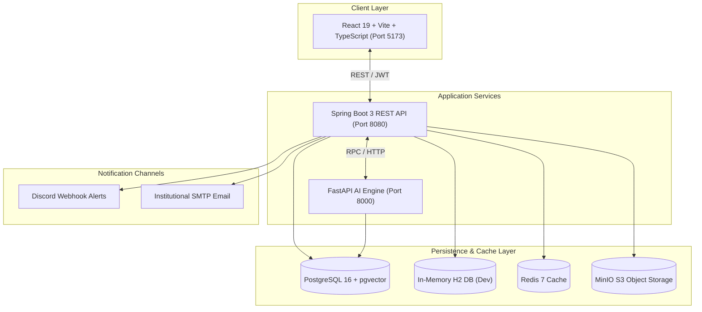

<div align="center">

# 🎓 AI-Powered College Project Lifecycle Management & Intelligence Platform (CPLMS)

**An enterprise-grade, full-stack academic project governance and lifecycle intelligence ecosystem.**

[](https://spring.io/projects/spring-boot)
[](https://fastapi.tiangolo.com/)
[](https://react.dev/)
[](https://www.typescriptlang.org/)
[](https://github.com/pgvector/pgvector)
[](https://www.docker.com/)
[](https://discord.com/)
[](#-license)

[Key Features](#-core-features) • [System Architecture](#-system-architecture) • [Quick Start](#-quick-start-options) • [Demo Accounts](#-pre-seeded-demo-accounts) • [API & Endpoints](#-system-endpoints) • [Project Structure](#-project-structure)

</div>

---

## 📌 Overview

**CPLMS** is an automated academic project management platform engineered to resolve the administrative bottleneck in university capstone and minor projects. It replaces ad-hoc spreadsheets and disjointed communication with:

- 🤖 **AI-Powered Proposal Screening** — cosine-similarity novelty and duplicate detection against institutional project archives.
- ⚖️ **Fair Guide Allocation** — strict capacity constraints preventing faculty workload burnout.
- 📊 **Granular Contribution Tracking** — proof-of-work commit and milestone tracking with team-lead sign-offs.
- 👥 **Multi-Stakeholder Governance** — dedicated role-based portals for Students, Mentors, Section Coordinators, Department Heads, Review Panels, and Administrators.

---

## 🏗️ System Architecture



---

## 🌟 Core Features

### 1. 🤖 AI Vector Novelty & Redundancy Screening
- Vectorizes submitted abstracts and project methodologies using semantic embeddings.
- Flags submissions with ≥70% cosine similarity against past academic repositories to prevent plagiarism and duplicate work.

### 2. ⚖️ Guide Workload Balancer
- Enforces dynamic faculty capacity limits (e.g., maximum 3 teams per guide) to maintain high-quality mentorship.
- Empowers Coordinators to balance loads across departments seamlessly.

### 3. 👥 Team Formation State Machine
- Strict team constraints (2–4 members) with formal invitation workflows (Pending → Accepted → Locked).
- Only complete, lead-approved teams can submit proposals.

### 4. 📊 Two-Level Contribution Tracking
- **Level 1 (Self-Report):** students log module hours, task summaries, and GitHub commit references.
- **Level 2 (Lead & Mentor Sign-Off):** team leads review peer claims before final evaluation by the faculty guide.

### 5. 🔔 Dual-Channel Notification Engine
- Real-time institutional email delivery and rich, color-coded Discord Webhook cards for team invites, proposal approvals, review reminders, and milestone deadlines.

### 6. 📑 AI-Assisted Bulk Excel Roster Ingestion
- Upload standard student/faculty rosters (`.xlsx` or `.csv`).
- Built-in AI reconciliation auto-maps inconsistent column names to platform schema targets.

---

## 🚀 Quick Start Options

### ⚡ Option 1: 1-Click Launch (Windows)
Double-click the root batch script to automatically launch all 3 microservices in dedicated terminal windows:
```powershell
.\start-all.bat
```

### 🐳 Option 2: Docker Compose (Full Stack)
Spin up the entire ecosystem (Postgres + pgvector, Redis, MinIO, Spring Boot, FastAPI, and Frontend) in seconds:

```bash
# 1. Clone the repository
git clone https://github.com/SaiSreeHarsha2005/AI-powered-College-Project-Lifecycle-Management-System-CPLMS.git
cd AI-powered-College-Project-Lifecycle-Management-System-CPLMS

# 2. Copy environment template
cp .env.example .env

# 3. Start all containers
docker-compose up --build -d
```

### 🛠️ Option 3: Manual Terminal Setup

<details>
<summary><b>Click to expand step-by-step manual instructions</b></summary>

#### Terminal 1: FastAPI AI Microservice (Port 8000)
```powershell
cd ai-service
python -m venv venv
venv\Scripts\activate      # On Linux/macOS: source venv/bin/activate
pip install -r requirements.txt
python -m uvicorn app.main:app --host 127.0.0.1 --port 8000 --reload
```

#### Terminal 2: Spring Boot Backend (Port 8080)
```powershell
cd backend
# Using bundled Maven wrapper:
..\.tools\apache-maven-3.9.6\bin\mvn.cmd spring-boot:run
# Or if Maven is installed globally:
mvn spring-boot:run
```

#### Terminal 3: React Frontend (Port 5173)
```powershell
cd frontend
npm install
npm run dev
```

</details>

---

## 👤 Pre-Seeded Demo Accounts

The frontend includes a **1-Click Role Switcher** in the top navbar. You can also log in directly using the following credentials:

| Role | Email | Password | Primary Responsibilities |
| :--- | :--- | :--- | :--- |
| **Student (Team Lead)** | `student.lead@gcet.edu.in` | `password123` | Submit proposals, trigger AI novelty checks, invite members, verify contributions |
| **Student (Team Member)** | `student.member@gcet.edu.in` | `password123` | Accept/decline invites, log module hours, submit GitHub commits |
| **Internal Guide** | `internalguide@gcet.edu.in` | `password123` | Review proposals, mentor assigned teams, grade evaluation rubrics |
| **Section Coordinator** | `sectionguide@gcet.edu.in` | `password123` | Section-level monitoring, guide re-allocation, deadline management |
| **Overall Coordinator** | `coordinator@gcet.edu.in` | `password123` | Institution-wide policy, department allocations, final clearance |
| **Panel Reviewer** | `panel.member@gcet.edu.in` | `password123` | Blind rubric scoring across Problem Statement, Feasibility & Innovation |
| **Administrator** | `admin@gcet.edu.in` | `password123` | Bulk Excel/CSV imports, system configuration, audit trails |

> ⚠️ These are seeded **development-only** credentials. Rotate or disable them before any production or public-facing deployment.

---

## 🌐 System Endpoints

| Component | URL | Description |
| :--- | :--- | :--- |
| **Frontend Portal** | `http://localhost:5173` | React 19 UI with role-based dashboard views |
| **Backend REST API** | `http://localhost:8080` | Spring Boot 3 core services |
| **Swagger UI (Backend)** | `http://localhost:8080/swagger-ui.html` | Interactive OpenAPI 3.0 documentation |
| **H2 In-Memory DB** | `http://localhost:8080/h2-console` | Dev DB (JDBC: `jdbc:h2:mem:cplmsdb`, User: `sa`) |
| **FastAPI Microservice** | `http://localhost:8000` | AI vector analysis and NLP services |
| **FastAPI Docs** | `http://localhost:8000/docs` | Swagger documentation for AI endpoints |
| **MinIO Console** | `http://localhost:9001` | S3 object storage manager *(when running Docker)* |

---

## 📂 Project Structure

```text
├── ai-service/             # FastAPI NLP & AI vector microservice
│   ├── app/
│   │   ├── main.py         # Endpoints for duplicate checking & header mapping
│   │   └── services/       # Cosine similarity and vector algorithms
│   └── requirements.txt
├── backend/                # Spring Boot 3 enterprise API
│   ├── src/main/java/      # Domain models, controllers, services, repositories
│   ├── src/main/resources/ # application.yml, mock seed data, schema configs
│   └── pom.xml
├── frontend/                # React 19 + TypeScript + Vite UI
│   ├── src/
│   │   ├── components/     # Reusable UI widgets, modals, navbar
│   │   ├── pages/          # Role-specific dashboards (Student, Guide, Admin)
│   │   └── services/       # Axios API integration layer
│   └── package.json
├── docker-compose.yml      # Multi-container production deployment manifest
├── start-all.bat           # 1-click Windows development launcher
└── .env.example            # Environment variables configuration template
```

---

## 🧰 Tech Stack Summary

| Layer | Technology |
| :--- | :--- |
| Frontend | React 19, TypeScript, Vite |
| Core API | Spring Boot 3 (Java) |
| AI/NLP Microservice | FastAPI (Python) |
| Database | PostgreSQL 16 + pgvector, H2 (dev) |
| Cache | Redis 7 |
| Object Storage | MinIO (S3-compatible) |
| Notifications | Discord Webhooks, SMTP Email |
| Orchestration | Docker Compose |

---

## 📄 License

This project is licensed under the **MIT License** — feel free to use, modify, and distribute for academic and commercial purposes.
